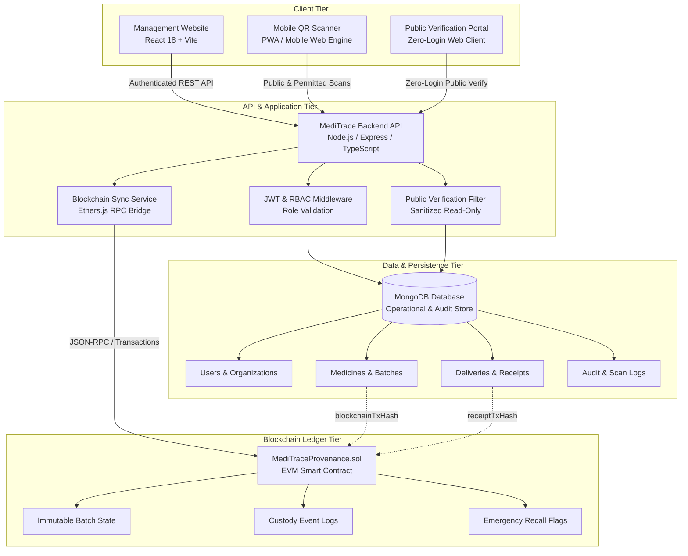

# MediTrace — System Architecture & Component Interaction Specification

**Version:** 2.0.0 (Phase 2 Baseline)  
**Author:** Kavi (System Architecture and Shared Foundation)  
**Project:** Decentralized Supply Chain Provenance for Pharmaceuticals  
**Repository:** `https://github.com/KAVIRAJ-27/-Decentralized-Supply-Chain-Provenance-for-Pharmaceuticals`

---

## 1. System Overview & Component Topology

MediTrace employs a hybrid Web2/Web3 architecture designed for high-throughput pharmaceutical logistics with immutable cryptographic trust. Operational records (commercial dispatch, warehousing details, organizations, user credentials, and sensor data) are managed in **MongoDB**, while critical provenance proofs (custody transitions, batch authenticity, and safety recalls) are anchored on the **Ethereum Blockchain**.

---

## 2. Core Components & Responsibilities

### 1. Management Website (Web Portal)
- **Framework:** React 18, Vite, TypeScript, Vanilla CSS (Deep Obsidian Medical Design System).
- **Target Users:** Authenticated institutional actors (`ADMIN`, `MANUFACTURER`, `DISTRIBUTOR`, `PHARMACY`, `HOSPITAL`).
- **Sub-Dashboards:**
  - **Admin Dashboard (`/admin`):** Network governance, organizational participant accreditation, compliance auditing, and emergency recall broadcast.
  - **Manufacturer Dashboard (`/manufacturer`):** Medicine formulation registration, batch minting (`MED-YYYYMMDD-XXXXX`), QR generation, and outbound dispatch.
  - **Distributor Dashboard (`/distributor`):** Inbound shipment verification, warehouse cold-chain intake, inventory holding, and hospital/pharmacy dispatch.
  - **Pharmacy / Hospital Dashboard (`/pharmacy`, `/hospital`):** Physical receipt confirmation, dispensary inventory management, and patient dispensation recording.

### 2. Mobile QR Scanner (Mobile Web / PWA Engine)
- **Scope:** Dedicated mobile inspection client.
- **Strict Boundary:** 
  - Scans standardized batch QR codes.
  - Displays permitted medicine specifications (active ingredients, dosage, manufacturer, expiry, recall alert).
  - Validates cryptographic authenticity against backend verification routes.
  - **Non-Functional Rule:** The mobile scanner does **NOT** manage operational inventory, dispatch shipments, or alter delivery statuses. It is an inspection and audit tool.

### 3. Public Verification Portal (`/verify/:batchId`)
- **Access Rule:** Public read-only; **zero login or authentication required**.
- **Data Protection Guarantee:**
  - Displays only approved public attributes: Drug Name, Generic Name, Dosage, Manufacturer, Manufacturing Date, Expiry Date, Authenticity Status, Recall Status, and High-Level Custody Timeline.
  - **Never exposes:** Private organizational inventory quantities, commercial pricing, user passwords, email addresses, employee names, or internal warehouse notes.

### 4. Backend API
- **Runtime:** Node.js, Express, TypeScript.
- **Responsibilities:**
  - Institutional authentication via JWT, password hashing with bcrypt, and role-based access control (RBAC).
  - Validation of standardized Batch IDs using regex: `/^MED-\d{8}-[A-Z0-9]{4,8}$/`.
  - Delivery lifecycle enforcement: `PENDING` &rarr; `DISPATCHED` &rarr; `IN_TRANSIT` &rarr; `DELIVERED`.
  - Enforcement that deliveries **never** transition to `DELIVERED` automatically upon QR scan; explicit institutional receipt confirmation is strictly required.
  - Bi-directional bridge to the Ethereum blockchain: submitting custody transactions and extracting transaction hashes.

### 5. MongoDB Database
- **Role:** Master operational datastore.
- **Managed Entities:** Organizations, Users, Medicines, MedicineBatches, SupplyChainTransactions, Deliveries, ReceiptConfirmations, BatchHistory, and permitted scan alerts.
- **Integrity Design:** Validated document references, unique indices on user emails and batch IDs, schema-level type enforcement, and transactional integrity.

### 6. Blockchain Ledger (Ethereum / EVM)
- **Contract:** `MediTraceProvenance.sol` (Solidity 0.8.20).
- **Role:** Immutable public provenance and anti-counterfeiting verification anchor.
- **On-Chain Data:**
  - Batch creation timestamp, manufacturer wallet, drug identifier.
  - State custody updates signed by verified private keys.
  - Cryptographic transaction hashes and block numbers.
  - Permanent, irrevocable recall flags.
- **Off-Chain vs On-Chain Split:** Detailed logistics (driver names, truck numbers, contact emails, warehouse notes) remain in MongoDB to minimize gas fees and preserve business privacy; cryptographic receipts and status proofs are committed on-chain.

---

## 3. Data Flow & Communication Patterns

### A. Batch Creation & Blockchain Anchoring
1. Manufacturer submits batch parameters to `POST /api/batches`.
2. Backend validates manufacturer's accredited role and payload.
3. Backend creates `MedicineBatch` in MongoDB with status `MANUFACTURED`.
4. Blockchain Service signs and submits `createBatch(...)` transaction to `MediTraceProvenance.sol`.
5. The resulting transaction hash (`blockchainTxHash`) and block number are saved into MongoDB.
6. Unified QR code payload is generated referencing the immutable `batchId`.

### B. Shipment Dispatch & Delivery Lifecycle
1. Sender (`MANUFACTURER` or `DISTRIBUTOR`) initiates a dispatch via `POST /api/deliveries`.
2. A `Delivery` record is generated with status `DISPATCHED` / `IN_TRANSIT`.
3. Inventory in the sender's warehouse is decremented or quarantined in transit.
4. An on-chain `transferBatch(...)` transaction is submitted, logging transit temperature and dispatch location.

### C. Physical Custody Confirmation
1. Receiving organization (`DISTRIBUTOR`, `PHARMACY`, or `HOSPITAL`) receives physical shipment.
2. The receiver inspects seals, verifies temperature logs, and calls `POST /api/deliveries/:deliveryId/confirm-receipt`.
3. The delivery status is explicitly set to `DELIVERED`.
4. A `ReceiptConfirmation` entity is recorded in MongoDB.
5. Smart contract `receiveBatch(...)` is executed to transfer owner custody on the blockchain ledger.

### D. Zero-Login Public Verification
1. Consumer, patient, or inspector opens `/verify/:batchId` or scans the QR code.
2. Browser issues `GET /api/public/verify/:batchId`.
3. Backend fetches batch metadata from MongoDB and validates integrity against the smart contract state.
4. Response is filtered through `PublicBatchVerificationResponse` ensuring zero private data leakage.
