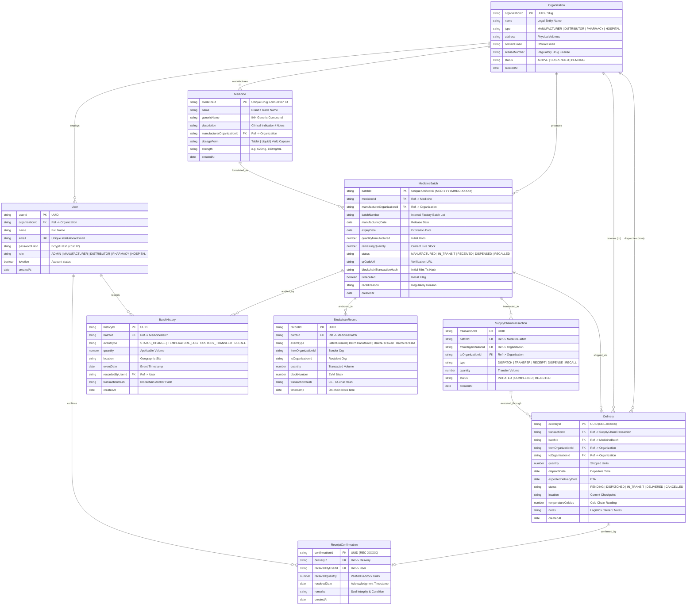

# MediTrace — Database Architecture & Data Dictionary

**Version:** 2.0.0 (Phase 2 Baseline)  
**Database Engine:** MongoDB (Document Store with Validated Schema References & Unique Indices)  
**Author:** Kavi (System Architecture and Shared Foundation)

---

## 1. Entity-Relationship (ER) Diagram



---

## 2. Comprehensive Data Dictionary

### Collection 1: `organizations`
Primary store for all accredited supply chain institutions.

| Field | BSON Type | Constraints & Rules | Description |
|---|---|---|---|
| `organizationId` | String | **PK**, Required, Unique, Format: `ORG-XXXXXX` | Primary identifier |
| `name` | String | Required, Trim, Max: 200 | Registered corporate or healthcare facility name |
| `type` | String | Enum: `MANUFACTURER`, `DISTRIBUTOR`, `PHARMACY`, `HOSPITAL` | Accredited entity operational role |
| `address` | String | Required | Physical manufacturing plant, warehouse, or facility |
| `contactEmail` | String | Required, Valid Email format | Official compliance contact email |
| `licenseNumber` | String | Required, Unique, Uppercase | FDA, GMP, or state drug authority license ID |
| `walletAddress` | String | 42-char Hex (`0x...`), Optional | EVM wallet address for smart contract verification |
| `status` | String | Enum: `ACTIVE`, `SUSPENDED`, `PENDING`, Default: `ACTIVE` | Institutional regulatory status |
| `createdAt` | Date | Required, Immutable | Entity onboarding timestamp |

*Indices:*
- `{ organizationId: 1 }` (Unique)
- `{ licenseNumber: 1 }` (Unique)
- `{ type: 1, status: 1 }` (Compound query index)

---

### Collection 2: `users`
Authenticated personnel tied to accredited organizations.

| Field | BSON Type | Constraints & Rules | Description |
|---|---|---|---|
| `userId` | String | **PK**, Required, Unique, Format: `USR-XXXXXX` | User identifier |
| `organizationId` | String | **FK** -> `organizations.organizationId`, Required | Parent employing organization |
| `name` | String | Required, Trim | Full name of staff member |
| `email` | String | **Unique**, Lowercase, Valid Email | Institutional work email for login |
| `passwordHash` | String | Required, Bcrypt hash (cost &ge; 12) | **Never plain text** |
| `role` | String | Enum: `ADMIN`, `MANUFACTURER`, `DISTRIBUTOR`, `PHARMACY`, `HOSPITAL` | Role-based authorization permission |
| `isActive` | Boolean | Default: `true` | Account access toggle |
| `createdAt` | Date | Required | Account creation timestamp |

*Indices:*
- `{ email: 1 }` (Unique)
- `{ organizationId: 1, role: 1 }` (Compound query index)

---

### Collection 3: `medicines`
Master pharmaceutical drug formulations approved for manufacture.

| Field | BSON Type | Constraints & Rules | Description |
|---|---|---|---|
| `medicineId` | String | **PK**, Required, Unique, Format: `MED-FORM-XXXX` | Formulation SKU identifier |
| `name` | String | Required, Trim | Commercial trade name (e.g. *Amoxicillin Clavulanate*) |
| `genericName` | String | Required, Trim | INN Generic pharmaceutical compound name |
| `description` | String | Max: 2000 | Clinical indications, storage instructions |
| `manufacturerOrganizationId` | String | **FK** -> `organizations.organizationId`, Required | Producing licensed laboratory |
| `dosageForm` | String | Required (e.g., *Tablet, Injection, Oral Suspension*) | Galenical dosage format |
| `strength` | String | Required (e.g., *625mg, 500mg/100mL*) | Active pharmaceutical ingredient concentration |
| `createdAt` | Date | Required | Catalog entry creation timestamp |

*Indices:*
- `{ medicineId: 1 }` (Unique)
- `{ manufacturerOrganizationId: 1, name: 1 }` (Compound index)

---

### Collection 4: `medicine_batches`
Physical pharmaceutical batches formulated and tracked on ledger.

| Field | BSON Type | Constraints & Rules | Description |
|---|---|---|---|
| `batchId` | String | **PK**, **Unique**, Regex: `^MED-\d{8}-[A-Z0-9]{4,8}$` | Universal Batch Identifier |
| `medicineId` | String | **FK** -> `medicines.medicineId`, Required | Linked medicine catalog formulation |
| `manufacturerOrganizationId` | String | **FK** -> `organizations.organizationId`, Required | Producing manufacturer |
| `batchNumber` | String | Required, Unique within manufacturer | Internal factory lot code |
| `manufacturingDate` | Date | Required, Must be in the past | Release date from laboratory |
| `expiryDate` | Date | Required, **Must be > manufacturingDate** | Expiration shelf-life limit |
| `quantityManufactured` | Number | Integer, Positive (`> 0`) | Total physical units synthesized |
| `remainingQuantity` | Number | Integer, `0 <= remainingQuantity <= quantityManufactured` | Live untransferred stock units |
| `status` | String | Enum: `MANUFACTURED`, `IN_TRANSIT`, `RECEIVED`, `DISPENSED`, `RECALLED` | High-level status |
| `qrCodeUrl` | String | Valid URL format | Static public verification endpoint URL |
| `blockchainTransactionHash` | String | 66-char Hex (`0x...`), Optional | EVM transaction hash on minting |
| `isRecalled` | Boolean | Default: `false` | Permanent emergency safety recall flag |
| `recallReason` | String | Required if `isRecalled === true` | Official regulatory defect rationale |
| `createdAt` | Date | Required | Batch formulation timestamp |

*Indices:*
- `{ batchId: 1 }` (Unique)
- `{ manufacturerOrganizationId: 1, batchNumber: 1 }` (Compound Unique Index)
- `{ isRecalled: 1, expiryDate: 1 }` (Surveillance index)

---

### Collection 5: `supply_chain_transactions`
Commercial transfer manifests linking parties.

| Field | BSON Type | Constraints & Rules | Description |
|---|---|---|---|
| `transactionId` | String | **PK**, Required, Format: `TXN-XXXXXX` | Transaction manifest identifier |
| `batchId` | String | **FK** -> `medicine_batches.batchId`, Required | Target medicine batch |
| `fromOrganizationId` | String | **FK** -> `organizations.organizationId`, Required | Custody transferor |
| `toOrganizationId` | String | **FK** -> `organizations.organizationId`, Required | Custody transferee |
| `type` | String | Enum: `DISPATCH`, `TRANSFER`, `RECEIPT`, `DISPENSE`, `RECALL` | Operational transaction category |
| `quantity` | Number | Integer, Positive (`> 0`) | Transacted unit volume |
| `status` | String | Enum: `INITIATED`, `COMPLETED`, `REJECTED` | Commercial state |
| `createdAt` | Date | Required | Transaction record timestamp |

---

### Collection 6: `deliveries`
Active transit logistics, cold-chain monitoring, and dispatch records.

| Field | BSON Type | Constraints & Rules | Description |
|---|---|---|---|
| `deliveryId` | String | **PK**, Required, Unique, Format: `DEL-XXXXXX` | Logistics delivery tracking ID |
| `transactionId` | String | **FK** -> `supply_chain_transactions.transactionId` | Originating commercial order |
| `batchId` | String | **FK** -> `medicine_batches.batchId`, Required | Shipped batch |
| `fromOrganizationId` | String | **FK** -> `organizations.organizationId`, Required | Dispatching organization |
| `toOrganizationId` | String | **FK** -> `organizations.organizationId`, Required | Receiving destination organization |
| `quantity` | Number | Integer, Positive (`> 0`) | Shipped container quantity |
| `dispatchDate` | Date | Required | Physical departure timestamp |
| `expectedDeliveryDate` | Date | Required | Estimated arrival timestamp |
| `status` | String | Enum: `PENDING`, `DISPATCHED`, `IN_TRANSIT`, `DELIVERED`, `CANCELLED` | Active logistics delivery status |
| `location` | String | Required (e.g. *Interstate Highway 95 Reefer Fleet #4*) | Last recorded sensor waypoint |
| `temperatureCelsius` | Number | Decimal, Allowed: `-80.0` to `50.0` | Active IoT cold-chain telemetry |
| `notes` | String | Max: 1000 | Carrier bill-of-lading, packaging specs |
| `createdAt` | Date | Required | Delivery dispatch creation timestamp |

*Delivery Status Lifecycle Rules:*
```text
           +------------+
           |  PENDING   |
           +-----+------+
                 | (Dispatcher creates manifest)
                 v
           +-----+------+
           | DISPATCHED |
           +-----+------+
                 | (Carrier takes possession)
                 v
           +-----+------+
           | IN_TRANSIT | <----+ (Periodic IoT temp updates)
           +-----+------+      |
                 |             |
                 +-------------+
                 |
                 | (RECEIVING ORGANIZATION EXPLICITLY CONFIRMS RECEIPT)
                 v
           +------------+
           | DELIVERED  |
           +------------+
                 |
                 +-----> CANCELLED (If shipment aborted/lost in transit)
```
> **CRITICAL RULE:** A delivery must **never** transition to `DELIVERED` simply because a barcode or QR code was scanned. The authorized receiving organization (`DISTRIBUTOR`, `PHARMACY`, or `HOSPITAL`) must submit an explicit receipt confirmation transaction via `POST /api/deliveries/:deliveryId/confirm-receipt`.

---

### Collection 7: `receipt_confirmations`
Formal receipt handoff certificates confirming goods arrival and integrity.

| Field | BSON Type | Constraints & Rules | Description |
|---|---|---|---|
| `confirmationId` | String | **PK**, Required, Unique, Format: `REC-XXXXXX` | Confirmation certificate ID |
| `deliveryId` | String | **FK** -> `deliveries.deliveryId`, Required | Linked delivery shipment |
| `receivedByUserId` | String | **FK** -> `users.userId`, Required | Authenticated employee recording intake |
| `receivedQuantity` | Number | Integer, Positive (`> 0`) | Counted units accepted into inventory |
| `receivedDate` | Date | Required | Date and time received |
| `remarks` | String | Max: 1000 | Packaging seal inspection, container checks |
| `createdAt` | Date | Required | Confirmation stamp timestamp |

---

### Collection 8: `batch_history`
Granular internal audit logs of every touchpoint on the medicine batch.

| Field | BSON Type | Constraints & Rules | Description |
|---|---|---|---|
| `historyId` | String | **PK**, Required, Format: `HIST-XXXXXX` | Audit log record ID |
| `batchId` | String | **FK** -> `medicine_batches.batchId`, Required | Target medicine batch |
| `eventType` | String | Required (e.g. `MANUFACTURED`, `DISPATCHED`, `INTAKE_CONFIRMED`, `TEMP_ALERT`, `DISPENSED`, `RECALLED`) | Audit event trigger |
| `quantity` | Number | Integer | Transacted quantity at event |
| `location` | String | Required | Physical GPS/facility venue |
| `eventDate` | Date | Required | Event timestamp |
| `recordedByUserId` | String | **FK** -> `users.userId` (or `SYSTEM`) | Staff actor responsible |
| `transactionHash` | String | 66-char Hex (`0x...`), Optional | Linked on-chain transaction hash |
| `createdAt` | Date | Required | Record timestamp |

---

### Collection 9: `blockchain_records`
Cross-referencing index connecting MongoDB entities with EVM ledger state.

| Field | BSON Type | Constraints & Rules | Description |
|---|---|---|---|
| `recordId` | String | **PK**, Required, Format: `BCR-XXXXXX` | Ledger index identifier |
| `batchId` | String | **FK** -> `medicine_batches.batchId`, Required | Monitored medicine batch |
| `eventType` | String | Enum: `BatchCreated`, `BatchTransferred`, `BatchReceived`, `MedicineDispensed`, `BatchRecalled` | Smart contract event name |
| `fromOrganizationId` | String | Optional (Empty for initial mint) | Originating organization |
| `toOrganizationId` | String | Optional | Destination organization |
| `quantity` | Number | Integer | Units stamped on-chain |
| `blockNumber` | Number | Integer, &ge; 0 | EVM block height |
| `transactionHash` | String | 66-char Hex (`0x...`), Unique | Ethereum transaction hash |
| `timestamp` | Date | Required | Block timestamp |

---

## 3. Data Integrity & Security Rules

1. **Password Safety:** All user passwords must be hashed using `bcrypt` with a minimum salt work factor of 12 before persistence. No plain-text passwords may ever appear in databases, logs, or API payloads.
2. **Authorization Enforcement:** Server-side middleware must independently verify that the authenticated user's `organizationId` matches the batch's current holding organization. Client-submitted organization identifiers in request bodies must **never** be trusted without authorization verification.
3. **Immutability of Batch Identifiers:** Once registered, a `batchId` (`MED-YYYYMMDD-XXXXX`) cannot be modified, renamed, or deleted.
4. **Data Isolation:** Public endpoints (`/api/public/verify/:batchId`) must use sanitized projection types (`PublicBatchVerificationResponse`), stripping all operational quantities, commercial pricing, user personal identities, and server internals.
