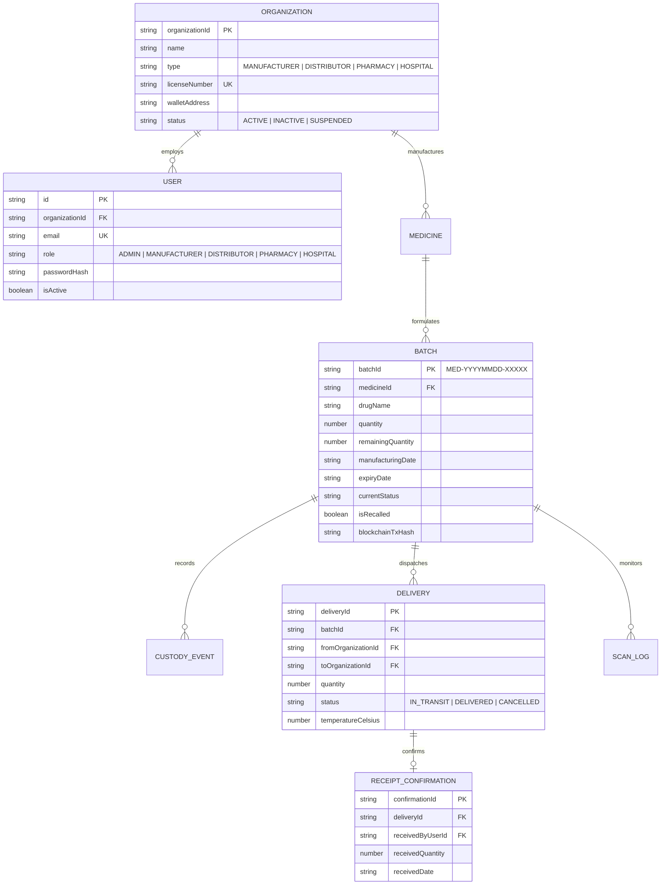

# MediTrace — Comprehensive Demonstration Guide & Final Audit

**Project:** MediTrace — Decentralized Supply Chain Provenance for Pharmaceuticals  
**Repository:** `https://github.com/KAVIRAJ-27/-Decentralized-Supply-Chain-Provenance-for-Pharmaceuticals`  
**Authors:** Kavi (System Architecture, Blockchain, Backend & Public Provenance) & Kani (Distributor & Pharmacy Modules)

---

## 1. Project Introduction & Problem Statement

### The Problem
Counterfeit, adulterated, expired, and stolen pharmaceuticals present an acute global health hazard:
- Over **$200 billion annually** in counterfeit drugs flood global supply chains (WHO).
- Fragmented proprietary enterprise databases create information silos where bad actors inject fake lots, clone labels, and tamper with expiry dates.
- End-consumers and dispensing pharmacists lack instant, verifiable provenance to confirm if a medication was handled within acceptable cold-chain tolerances (`2°C - 8°C`) or subjected to a regulatory recall.

### The Solution: MediTrace
MediTrace establishes a unified, decentralized provenance architecture combining:
1. **Ethereum Smart Contracts (`MediTraceProvenance.sol`)**: Tamper-evident ledger providing immutable records of batch synthesis, custody transfers, temperature surveillance, and emergency recalls.
2. **Standardized GS1-Compatible QR Codes**: Cryptographically formatted batch identifiers (`MED-YYYYMMDD-XXXXX`) embedded into vector SVG labels and printable GMP packaging slips.
3. **Strict Zero-Login Public Verification**: Consumers and patients instantly scan packaging to view authentic manufacturing records and cold-chain compliance without login or data leakage.
4. **Enforced Separation of Concerns & Role-Based Custody**: Strict boundaries ensuring only authorized custodians (Manufacturers, Distributors, Pharmacies, Hospitals) can dispatch or acknowledge stock intake.

---

## 2. System Architecture & Technology Stack

```
                          ┌────────────────────────────────────────────────────────┐
                          │            MediTrace Smart Contract Layer             │
                          │        (MediTraceProvenance.sol / Hardhat 31337)       │
                          └──────────────────────────▲─────────────────────────────┘
                                                     │ JSON-RPC (ethers.js v6)
                          ┌──────────────────────────┴─────────────────────────────┐
                          │               Node.js / Express API Gateway            │
                          │           (/api/auth, /api/batches, /api/deliveries)   │
                          └──────┬───────────────────┬──────────────────────┬──────┘
                                 │                   │                      │
             ┌───────────────────┴───┐     ┌─────────┴─────────┐     ┌──────┴────────────────┐
             │   Admin & Regulator   │     │   Logistics & Mfg │     │   Public & Patient    │
             │   Management Portal   │     │   Custody Portals │     │   Verification Web/App│
             │   (AdminPage.tsx)     │     │   (Distributor /  │     │   (PublicVerifyPage   │
             │                       │     │    Pharmacy Pages)│     │    & Mobile App)      │
             └───────────────────────┘     └───────────────────┘     └───────────────────────┘
```

### Technology Stack:
- **Blockchain Core:** Solidity `0.8.24`, OpenZeppelin Contracts v5, Hardhat, Ethers.js v6.
- **Backend API:** TypeScript, Node.js, Express 4.19, JSON Web Tokens (JWT), PBKDF2 cryptography.
- **Frontend Dashboards:** React 18, TypeScript, Vite, Vanilla CSS with custom glassmorphic design system.
- **Mobile QR Scanner:** React 18, TypeScript, Vite PWA, HTML5 MediaDevices camera API, Canvas QR parser.
- **Shared Module:** `@meditrace/shared` defining unified interfaces, regex validators, and API contracts.

---

## 3. Entity-Relationship & Database Design



---

## 4. Test Credentials & Seed Data

The database is seeded with verified organizations and PBKDF2-hashed test accounts ready for demonstration:

| Role | Organization | Seeded Email | Password | Seeded Wallet Address |
|---|---|---|---|---|
| **ADMIN** | National Drug Regulatory Authority | `admin@meditrace.org` | `admin123` | `0xf39Fd6e51aad88F6F4ce6aB8827279cffFb92266` |
| **MANUFACTURER** | Apex Biotech Pharmaceuticals Ltd. | `manufacturer@apexpharma.com` | `mfg123` | `0x70997970C51812dc3A010C7d01b50e0d17dc79C8` |
| **DISTRIBUTOR** | Global Health Logistics & Cold Chain | `distributor@ghlogistics.com` | `dist123` | `0x3C44CdDdB6a900fa2b585dd299e03d12FA4293BC` |
| **PHARMACY** | City Care Hospital & Central Pharmacy | `pharmacy@citycare.org` | `pharm123` | `0x90F79bf6EB2c4f870365E785982E1f101E93b906` |
| **HOSPITAL** | St. Jude University Medical Center | `hospital@stjude.org` | `hosp123` | `0x15d34AAf54267DB7D7c367839AAf71A00a2C6A65` |

---

## 5. Live Demonstration Script (Step-by-Step)

### Step 1: Admin Governance & Regulatory Onboarding
1. Open web dashboard at `http://localhost:5173`.
2. Click **Sign In** and authenticate as Regulatory Admin:
   - Email: `admin@meditrace.org` / Password: `admin123`.
3. Navigate to **Admin Governance**:
   - Inspect accredited participants across Manufacturers, Distributors, and Pharmacies.
   - Show administrative activity audit logs (`ORGANIZATION_ACCREDITED`, `USER_PROVISIONED`).
   - Demonstrate deactivation protection: deactivated accounts are barred from obtaining session tokens.

### Step 2: Manufacturer Formulation & QR Generation
1. Switch to Manufacturer account:
   - Email: `manufacturer@apexpharma.com` / Password: `mfg123`.
2. Navigate to **Manufacturer Console**:
   - Show active drug catalog and register a new formulation (e.g. *CardioSafe 20mg*).
   - Formulate a new medicine batch with 10,000 units, setting production date and 2-year expiry.
3. Open the generated Batch QR code:
   - View vector SVG QR label and click **Print GMP Packaging Label** to show formatted GS1 packaging slip.
   - Demonstrate date validation: setting `expiryDate <= manufacturingDate` is strictly blocked.

### Step 3: Distributor Intake & Cold-Chain Dispatch
1. Switch to Distributor account:
   - Email: `distributor@ghlogistics.com` / Password: `dist123`.
2. Navigate to **Logistics & Distributor Console**:
   - Confirm intake of manufacturer shipment into warehouse cold storage with sensor reading (`4.2°C`).
   - Click **Dispatch Outbound to Pharmacy / Hospital**:
     - Select recipient: *City Care Hospital & Central Pharmacy*.
     - Specify quantity: 2,500 units.
     - Transport details: Refrigerated Fleet Truck #14 with cold-chain sensor reading (`4.5°C`).
   - Confirm dispatch: observe that batch remaining inventory immediately decrements from 10,000 to 7,500.

### Step 4: Pharmacy Intake & Physical Receipt Confirmation
1. Switch to Pharmacy account:
   - Email: `pharmacy@citycare.org` / Password: `pharm123`.
2. Navigate to **Pharmacy & Hospital Dispensary Console**:
   - View pending inbound shipment under **Incoming Deliveries**.
   - **Crucial Rule Highlight:** The delivery is NOT marked completed by merely scanning a barcode.
   - Click **Inspect & Confirm Delivery Receipt**:
     - Confirm physical delivery condition and verify quantity received (2,500 units).
     - Enter inspection remarks: *"Physical security seals intact, temperature logger within 2-8°C specs"*.
   - Submit: Delivery status transitions to `DELIVERED`, batch status becomes `RECEIVED_BY_PHARMACY`, and stock appears in **Dispensary Inventory**.
   - Demonstrate duplicate prevention: repeating confirmation is rejected with `400 ALREADY_DELIVERED`.

### Step 5: Clinical Patient Dispensation
1. In Pharmacy Dispensary Inventory, locate the verified batch.
2. Click **💊 Dispense to Patient**:
   - Specify units: 30 units.
   - Prescription Reference: `RX-2026-CARDIO-881`.
   - Submit: Inventory updates to 2,470 units, and dispensation event is permanently appended to provenance history.

### Step 6: Public Zero-Login Verification (Web & Mobile)
1. Open a private/incognito browser window at `http://localhost:5173/verify/MED-20261015-A8F2K` (or open the Mobile Scanner at `http://localhost:5174`).
2. Notice: **No authentication or account login is required**.
3. Inspect verified provenance timeline:
   - Milestone 1: Manufactured at Apex Biotech Formulation Suite (`20.5°C`).
   - Milestone 2: Dispatched in cold reefer container (`4.5°C`).
   - Milestone 3: Received at Global Health Logistics Hub Vault 3 (`4.2°C`).
   - Milestone 4: Dispatched to City Care Medical Delivery Fleet (`4.8°C`).
   - Milestone 5: Confirmed receipt at City Care Inpatient Dispensary (`21.0°C`).
   - Milestone 6: Dispensed to patient under prescription reference.
4. Privacy audit: notice that proprietary total production quantities and warehouse stock balances are completely hidden from public view.

### Step 7: Negative & Counterfeit Scenarios
1. **Counterfeit Batch Detection:** Enter `MED-20261015-FAK99` into the mobile scanner or web verification.
   - View prominent red hazard banner: *"UNREGISTERED PHARMACEUTICAL — POTENTIAL COUNTERFEIT"*.
2. **Expired Batch Detection:** Inspect `MED-20261015-EXP01`.
   - View amber warning banner: *"EXPIRED PHARMACEUTICAL BATCH — DO NOT CONSUME"*.
3. **Emergency Recall Alert:** Trigger a recall as Admin/Manufacturer and scan `MED-20261015-REC02`.
   - View critical recall banner with official regulatory rationale: *"Particulate matter contamination identified in vial seal inspection"*.

---

## 6. Commands to Run the Complete Stack

```bash
# 1. Run all 165 automated tests across blockchain and backend
npm run test:all

# 2. Start the Backend API (Port 5000 / 5001)
npm run dev:backend

# 3. Start the Management Frontend Web Application (Port 5173)
npm run dev:frontend

# 4. Start the Mobile QR Scanner PWA (Port 5174)
npm run dev:mobile
```
